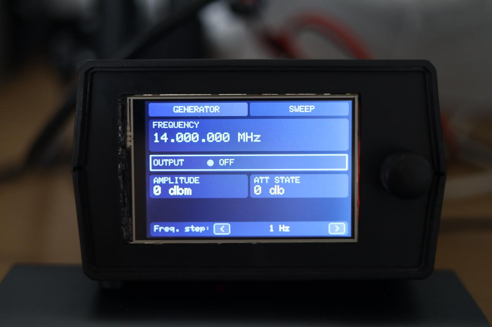
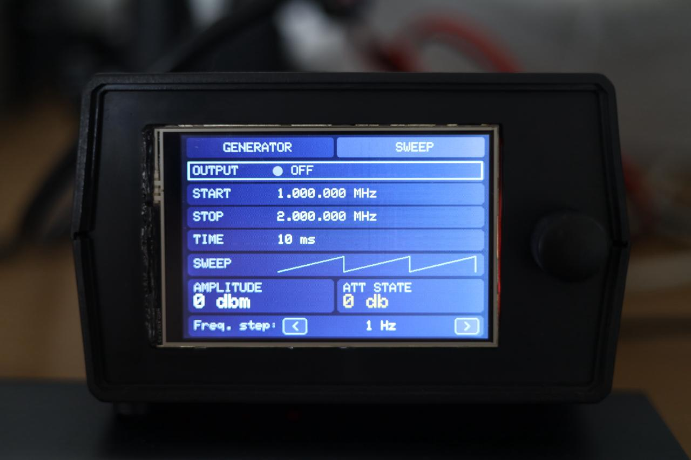

# SignalGenerator
 

### Main branch
 
Frontend for Gra&Afch AD9910 module. 
It has touch screen (ILI9488)/Encoder controls. 
BCD code output for external filters. 
LNA + ATT (Agilent 10-70db ATT) controls.  

### Screenshots

| Generator | Sweep |
| --- | --- |
|  |  |

### Frequency editing

- Tap a digit in the Generator frequency or Sweep Start/Stop value to select
  its decimal place. The selected digit is underlined.
- Turn the encoder to change the value by the selected decimal place.
- Press the encoder while a frequency field is selected to cycle through its
  displayed decimal places. The footer arrow buttons still adjust the step
  directly.

### Amplitude calibration

`amplitudeCalibration` in `SignalGenerator.ino` is reserved for measured DDS
gain corrections. It is empty by default, so amplitude commands are unchanged.
Add pairs in the form `{ requested gain, calibrated gain }`, ordered by the
requested value. Exact points are used directly and values between two points
are linearly interpolated. Values outside the measured range remain
uncalibrated.

### AD9851 branch

This branch carries the same interface and controls for a directly connected
AD9851 DDS:

- generator and timed sweep modes;
- touch and rotary-encoder frequency-digit editing;
- hardware output enable/disable through the AD9851 power-down bit;
- PE4302 output-level control and configurable calibration points;
- LNA control and BCD output for external band-pass filters;
- the dark instrument UI from `main`.

The supported frequency range remains 25 Hz to 30 MHz to match the original
AD9851 hardware and filter bank. The level is shown relative to the
unattenuated DDS output (`0` to `-31` dB), rather than as an absolute dBm
measurement.

### Arduino dependencies

- LCDWIKI GUI, KBV and TOUCH libraries
- Arduino Mega 2560 or compatible board

The PE4302 serial protocol is implemented directly in the sketch, so no
additional attenuator library is required.
